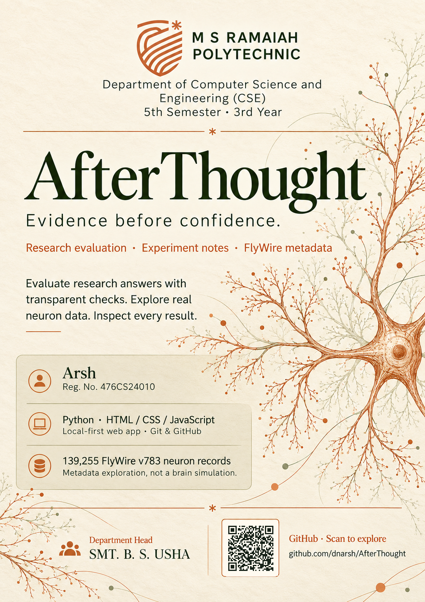

# AfterThought



**An evidence workspace by Arsh Talkhani.** Turn a research answer into inspectable checks, explore published fly-neuron metadata, and follow an investigation into the limits of AI judging.

AfterThought joins the real [Deep Research Bench](https://github.com/dnarsh/deep-research-bench) scorer, [Einstein’s Jump](https://github.com/dnarsh/einsteins-jump) research notebook, and a bounded connector to the official FlyWire FAFB v783 metadata archive. Its ivory workspace, copper controls, and olive data views keep the evidence at the center.

## Run locally

Python **3.8 or newer** is required. The app has **zero required runtime dependencies** and needs no model account or API key. Run from a source checkout:

```text
git clone https://github.com/dnarsh/AfterThought.git
cd AfterThought
python run_app.py --preload-connectome
```

Open **<http://127.0.0.1:8765>**. On Windows, double-click `start-app.cmd` instead; it also preloads the dataset. Keep the terminal open and stop the server with **Ctrl+C**. Use `--port 8766` if the default port is occupied.

The first FlyWire load needs internet and retrieves about **1.7 MB**. A valid local cache works afterward. `python run_app.py` starts without preloading; the dataset can be loaded explicitly from the app. If preloading fails, the app still starts and provides a retry action.

## One connected workflow

1. **Inspect a question.** Browse ten versioned public research cases and their regex, citation-count, and word-count requirements.
2. **Evaluate an answer.** Paste text and citation URLs, or run the explicitly labeled deterministic mock suite. The existing Python runner executes the three actual scorers.
3. **Use real dataset evidence.** Search FlyWire neuron IDs and groups, filter predicted neurotransmitters, and inspect confidence values. The current archive contains **139,255 records**, including **16,017 predicted GABA records**.
4. **Build a sourced brief.** The app calculates GABA’s **11.50%** share from the full snapshot, builds an editable deterministic summary, and evaluates it with the same three scorers. Change a count or remove a citation to inspect a failed check. This evidence case stays separate from the public ten-case suite.
5. **Keep the report.** Inspect each check and export the actual JSON or Markdown result. Browse Einstein’s Jump alongside the evidence to see why passing a check does not certify novelty.

The in-app **Live demo guide** provides **eight runnable steps** for a 6–8 minute presentation, including passing and failing answers, the mock suite, exact neuron lookup, and the dataset-to-brief workflow. See [the app guide](web/README.md) for the expected results and recovery steps.

## What the results mean

These are **structural checks**, not factual certification. Regex matching can be satisfied by text that repeats the expected terms; citation counting does not open or verify URLs; word count does not assess reasoning quality. No live research provider or LLM judge is connected. The FlyWire brief is a deterministic data summary, not an AI-generated conclusion.

The connector reads published **neuron metadata**, preserving full neuron IDs as strings. It does not load synaptic edges, simulate neural firing, model a fly, or use a brain to reason. Einstein’s Jump presents attributed historical findings, not experiments rerun by this app.

## Local data and privacy

The server binds to `127.0.0.1` and rejects unexpected Host and cross-origin requests. Submitted answers stay in request/response memory; this app does not send them to a provider or save them on the server. Drafts and up to 30 reports remain in browser memory until reload. Export a report before closing the page.

The public FlyWire archive is cached under ignored `.cache/flywire/`. Downloads and decoded data are bounded, one parsed snapshot is reused across queries, and a corrupt cache is replaced only after one successful validated refetch. Raw data is **not bundled or committed**.

## Checks and source

Install the development extra only when running the full test suite:

```text
python -m pip install -e ".[dev]"
python -m pytest -q
```

The added HTTP, metadata, and evidence-brief checks can also run with the standard library; commands and coverage are in [web/README.md](web/README.md#checks). The [framework reference](docs/framework.md) covers the preserved Python APIs, custom engines/scorers, and optional judge extension points.

## Credits and licenses

- **Application and scoring framework:** MIT; the original Deep Research Bench copyright and [license](LICENSE) are retained.
- **Research companion:** summaries link to Arsh’s MIT-licensed [Einstein’s Jump](https://github.com/dnarsh/einsteins-jump).
- **FlyWire FAFB v783 data:** **CC BY-NC 4.0**, separate from the code license. Follow [FlyWire’s use and citation guidelines](https://join.flywire.ai/guidelines). The [official Codex loader](https://github.com/murthylab/codex/blob/main/codex/data/local_data_loader.py) identifies the fixed archive source. The external [Codex explorer](https://codex.flywire.ai/app/explore) requires sign-in.
- **Fonts:** bundled Geist and Newsreader retain their SIL Open Font Licenses: [Geist](web/fonts/OFL.txt), [Newsreader](web/fonts/Newsreader-OFL.txt).
- **Visuals:** the neuron graphic is a schematic illustration, not measured connectivity.

[](https://github.com/dnarsh/AfterThought)

[github.com/dnarsh/AfterThought](https://github.com/dnarsh/AfterThought)
